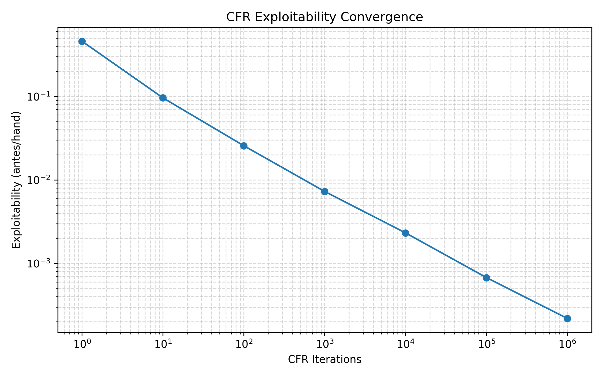

# Kuhn Poker CFR Solver

## Overview
A C++20 Kuhn Poker solver built on Counterfactual Regret Minimization (CFR), the algorithm family behind most modern poker solvers. After 1,000,000 iterations, exploitability is 0.000219 antes/hand (an ante is the forced 1-chip bet at the hand's start) and the learned strategy matches the known Kuhn equilibrium family. Includes a full unit test suite and a Makefile for easy building and running.

## Features
- **CFR solver:** self-play training that converges toward a Nash equilibrium over many iterations
- **Exploitability evaluator:** measures how much extra EV (in antes/hand) a best-responding opponent could win against the final strategy
- **Convergence evidence:** exploitability decreases toward zero and P1's starting EV approaches the theoretical -1/18
- **Unit tests:** cover game states, the information set table, solver output, and evaluator metrics
- **Configurable iterations:** set the CFR iteration count in `src/main.cpp`

## Results
Run `make run` from the project root to reproduce these results and print per-information-set EVs.

The table below shows solver convergence across increasing iteration counts. Starting EV represents P1's expected chips won or lost per hand, best response measures the strongest counter-strategy against the learned strategy, and exploitability measures the average additional EV available to a player by switching to a best response. Exploitability should approach zero as the solver converges toward a Nash equilibrium.

| Iterations | Starting EV for P1 | P1's Best Response | P2's Best Response | Exploitability |
|-----------:|-------------------:|-------------------:|-------------------:|---------------:|
| 1          | 0.125000  | 0.500000  | 0.416667 | 0.458333 |
| 10         | -0.035193 | 0.057000  | 0.135417 | 0.096209 |
| 100        | -0.055987 | -0.028620 | 0.079970 | 0.025675 |
| 1,000      | -0.055557 | -0.047681 | 0.062219 | 0.007269 |
| 10,000     | -0.055546 | -0.054345 | 0.058981 | 0.002318 |
| 100,000    | -0.055555 | -0.054770 | 0.056122 | 0.000676 |
| 1,000,000  | -0.055555 | -0.055206 | 0.055644 | 0.000219 |



Exploitability converges toward zero as iterations increase. P1's starting EV converges to the theoretical -1/18 (-0.055555...), P1's best response converges to that same value, and P2's best response converges to +1/18. Together, these show the solver approaching a Nash equilibrium.

<details>
<summary>View final learned strategy after 1,000,000 iterations</summary>

| Player | Private Card | Action History | Strategy |
|:------:|:------------:|:--------------:|:---------|
| P1 | J | Start | Bet = 20.7747%, Check = 79.2253% |
| P1 | Q | Start | Bet = 0%, Check = 100% |
| P1 | K | Start | Bet = 62.4668%, Check = 37.5332% |
| P2 | J | Check | Bet = 33.2686%, Check = 66.7314% |
| P2 | Q | Check | Bet = 0%, Check = 100% |
| P2 | K | Check | Bet = 100%, Check = 0% |
| P2 | J | Bet | Fold = 100%, Call = 0% |
| P2 | Q | Bet | Fold = 66.5864%, Call = 33.4136% |
| P2 | K | Bet | Fold = 0%, Call = 100% |
| P1 | J | Check → Bet | Fold = 100%, Call = 0% |
| P1 | Q | Check → Bet | Fold = 45.8390%, Call = 54.1610% |
| P1 | K | Check → Bet | Fold = 0%, Call = 100% |

</details>

The learned strategy is consistent with the known family of Kuhn equilibrium solutions. For example, if the probability of betting Jack is a, the probability of betting King should be 3a. At Start, Player 1 bets a Jack approximately 20.8% of the time and a King approximately 62.5% of the time, matching that 3x ratio. Additionally, after Check → Bet, P1 calls with a Queen approximately 54.2% of the time, close to the predicted 1/3 + *a* (about 54.1%). P2 also bluffs with a Jack after a Check about 1/3 of the time (33.3%), as predicted.

## Quick Start

### Requirements
- C++20
- `g++`
- `make`

Build/run the solver:

```bash
make run
```

Example output:

```text
Ran for 1000000 iterations:

Starting EV: -0.0555553
P1 Best Response: -0.0552061
P2 Best Response: 0.055644
Nash Convergence: 0.000437901
Exploitability: 0.00021895
```

Build/run the test files:

```bash
make test
```

Clean build files: 

```bash
make clean
```

Alternative commands:

```bash
# Run tests directly
./build/kuhn_test

# Run solver directly
./build/kuhn_solver
```

## Kuhn Poker Rules

Kuhn Poker is a simplified version of poker with two players. Each player initially antes 1 chip into the pot before being dealt 1 card of a 3-card deck containing a Jack, Queen, and King (where a King is the highest card). One card in the deck is left unused. The players then engage in one round of betting. Although the total possibilities in Kuhn Poker are small, the core game mechanics share many similarities with more complex variants of poker such as Texas Hold'em. Kuhn Poker is a useful benchmarking game that still incorporates concepts like imperfect information, mixed strategies, and information sets.

The rules of betting are below:

- Player 1 always goes first, with the option to check (bet nothing) or bet one chip.
- Facing a check, Player 2 can also check or bet a chip of their own. If Player 2 checks after Player 1 checks, the betting round is over.
- Facing a bet, Player 2 can call (match the bet with a chip of their own) or fold (concede the pot to Player 1, losing all the chips previously wagered but risking no more chips). The betting round is over after Player 2's action.
- Facing a bet from Player 2, Player 1 can call or fold as well. The betting round is over after Player 1's action.
- If neither player folds, the players go to showdown once the betting round is over, and whoever has the higher card wins the entire pot. If a player folds, the other player wins the pot without a showdown.

## How CFR Works
This CFR implementation groups indistinguishable game states into information sets. An information set represents a decision node where the player cannot differentiate between multiple possible game states because they do not know their opponent's card (e.g., a Q facing a bet does not know whether the opponent is holding K or J). CFR works by utilizing a metric named cumulative regret to generate strategies for each iteration. It then recurses down the game tree for each possible action, calculates the value of each action, and updates regrets for the next iteration. The following calculations are performed at every decision point in each iteration:

- If the node is terminal, somebody folded or the players went to showdown. Return the result in terms of P1's payoff (e.g., if P1 has K and P2 has Q, action history is Bet → Call, terminal state returns +2)
- Take the cumulative regrets from a global information set table. If both cumulative regrets are positive, normalize the strategies by the magnitude of their regrets. If both cumulative regrets are non-positive, generate a uniform strategy (50/50). If one action is positive and one negative, take the action with positive cumulative regret always.
- Calculate the expected information set value of taking each possible action. Then, calculate the value of the current strategy by multiplying the EV of each action by its frequency and summing both.
- Calculate the regrets of each action by subtracting the value of the total strategy from the value of each individual action. Then, update the cumulative regret table after weighting the effect of chance and the opponent's reach probability (how likely they are to let you reach this decision point).
- Update the average strategy with the current strategy values, weighted with your reach probability so that decision points you are more likely to reach end up being weighted more in the table.

After the algorithm is trained for a certain number of iterations, the cumulative strategy values are normalized for each action and presented. As the number of iterations approaches infinity, the solution approximates a Nash equilibrium.

## Architecture

### Project Structure

```text
KuhnPokerSolver/
├── include/     Header files
├── src/         Solver implementation
├── tests/       Unit tests
├── build/       Compiled binaries/object files
├── docs/
│   └── exploitability.png
├── scripts/
│   └── plot_convergence.py
├── Makefile
├── LICENSE
└── README.md
```

### Source Classes

The core solver logic is made up of 4 source classes:

- `GameState` - Represents the current Kuhn Poker game state, with instance variables being each player's card and the shared action history. Contains helpful methods such as determining payoffs in showdown/fold spots, returning whose turn it is, if that player can bet, etc. GameState objects are used for many tasks such as implementing CFR, calculating convergence metrics, and indexing information set tables.
- `InfoSetTable` — A class that stores cumulative regrets and cumulative strategy sums, containing methods such as printStrategy which normalizes the strategy sums at every information set and prints the results to the terminal. Global information set tables can persist across multiple iterations and evaluation calls.
- `Solve` — This class performs the core logic of CFR. Includes the train(InfoSetTable& i, int iterations) method, which populates the information set table with the solver results after 'iterations' iterations.
- `Evaluator` — Calculates metrics such as Nash convergence (the sum of both players' best-response gains), best response, strategy values, and exploitability.

## Testing
Every source file has a corresponding test file. These test files were made to ensure that core logic either runs properly or loudly throws exceptions whenever invalid function calls are made. For example, the `GameStateTests.cpp` file attempts to create GameState objects where both players have the same card, which is impossible under Kuhn Poker. Since the GameState implementation throws an exception when this occurs, the test passes. 

For more subjective tests, such as evaluating the metrics output by the Evaluator class, test results are dependent on whether the algorithm converges to theoretically known Nash equilibria. For example, if the solver's starting EV is within a set tolerance of the known Kuhn value (-1/18), the test will pass.

These tests provide an early warning signal if changes are made to the source files in the future.

The comprehensive suite of custom C++ unit tests is located under `tests/`. Every test result can be printed in the terminal using the command `make test` when in the project root.

## Future Work
- Implement CFR+ for faster convergence or Monte Carlo CFR to train through sampled portions of the game tree.
- Extend the solver to larger imperfect-information games such as Leduc Hold'em.

## License

This project is licensed under the MIT License. See `LICENSE` for details.